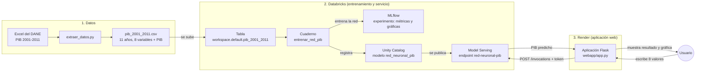
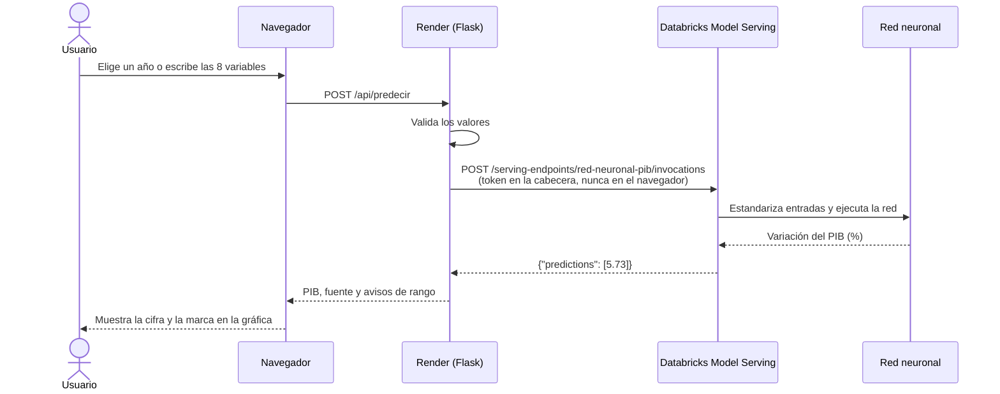
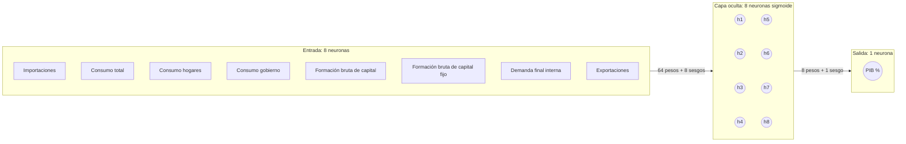

# Predicción del PIB de Colombia con una red neuronal en la nube

Red neuronal entrenada en **Databricks** con la base de conocimiento del DANE (2001-2011), publicada como servicio web con **Model Serving** y consumida por una aplicación web desplegada en **Render**.

**Aplicación en línea:** https://pib-red-neuronal.onrender.com

> El plan gratuito de Render apaga la aplicación tras 15 minutos sin uso y el servicio de Databricks escala a cero. La primera predicción después de un rato puede tardar uno o dos minutos.

---

## Cómo funciona todo



### Qué pasa en una predicción



---

## La red neuronal



| Elemento | Valor |
|---|---|
| Tipo | Perceptrón multicapa (`MLPRegressor` de scikit-learn) |
| Arquitectura | 8 → 8 → 1, activación sigmoide en la capa oculta |
| Parámetros aprendidos | 81 (64 + 8 + 8 + 1) |
| Preprocesamiento | Estandarización de entradas y salida (media 0, desviación 1) |
| Entrenamiento | Retropropagación con optimizador Adam, tasa de aprendizaje 0,01, regularización L2 α = 0,01 |
| Épocas | 1.539 (se detiene cuando el error deja de mejorar) |

Cada neurona oculta calcula `z = w1·x1 + … + w8·x8 + b` y luego `σ(z) = 1 / (1 + e^(−z))`. La neurona de salida combina las 8 activaciones con sus pesos y da la variación del PIB.

### Resultados (validación dejando un año fuera)

| Modelo | Error medio absoluto | R² |
|---|---|---|
| **Red neuronal 8-8-1** | **0,53 puntos** | **0,89** |
| Red con 1 neurona oculta | 1,00 puntos | 0,63 |
| Predecir siempre el promedio | 2,12 puntos | −0,21 |

---

## Estructura del repositorio

```
datos/                  Excel original del DANE, CSV limpio y script de extracción
databricks/             Cuaderno de entrenamiento (se importa en Databricks)
webapp/                 Aplicación web Flask
  app.py                Rutas: página principal, /api/predecir, /salud
  servicio.py           Cliente del endpoint de Databricks (o modelo incluido)
  templates/, static/   Interfaz
modelo_local/           Modelo de prueba para correr la web sin la nube
render.yaml             Configuración de despliegue en Render
GUIA.md                 Paso a paso para montar todo
```

## Correr la aplicación en local

```powershell
py -3.12 -m venv .venv
.venv\Scripts\activate
pip install -r requirements.txt
python webapp/app.py
```

Abre http://127.0.0.1:5000. Sin configurar nada, usa el modelo de prueba de `modelo_local/`. Para usar el servicio de Databricks, define `DATABRICKS_HOST`, `DATABRICKS_TOKEN` y `DATABRICKS_ENDPOINT` como variables de entorno o en `webapp/.env` (este archivo no se sube al repositorio).

## Tecnologías

Databricks Free Edition (cuadernos, MLflow, Unity Catalog, Model Serving) · scikit-learn · Flask · Render
